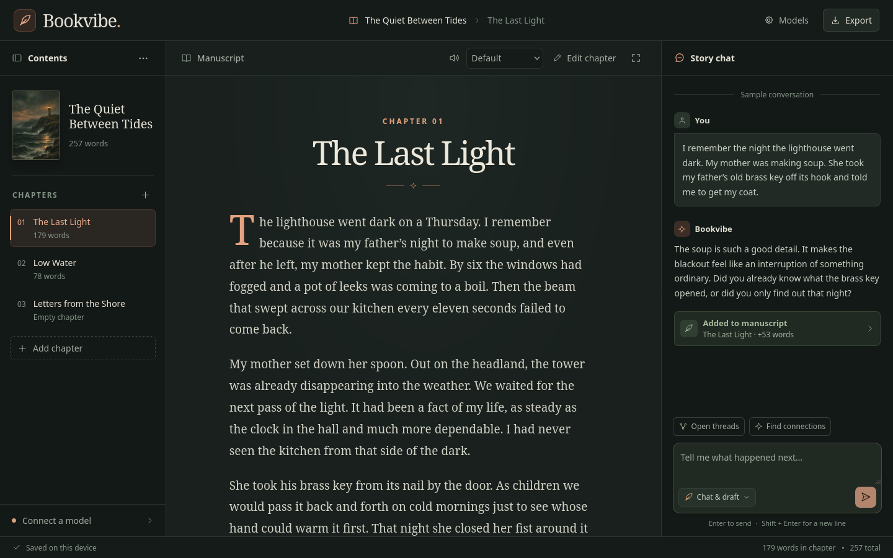

# Bookvibe

Bookvibe turns a conversation into a manuscript. Each message in **Chat & draft** gets a conversational reply and adds new paragraphs to the selected chapter. **Chat only** lets you discuss the book or ask about connections and open threads.

<p align="center">
  <a href="assets/bookvibe-desktop.png"></a>
</p>

## Run locally

```sh
bun install
bun run dev
```

Open the local URL printed by Vite. Use **Models** to set an OpenAI-compatible API base URL and model ID, plus an API key if the provider requires one. Enter the base URL, such as `https://api.openai.com/v1`. Bookvibe adds `/chat/completions`. Turn off the shared connection to configure chat and drafting independently.

The sample book shows how replies and new paragraphs appear in the workspace. Open **Book library** in the Contents header to create your own book. **Edit chapter** lets you revise the draft, and **Export** downloads the manuscript as Markdown.

Books, conversation history, and model URLs and IDs are saved in the browser. API keys stay in the browser tab’s session storage. Both selected providers receive the full conversation and current manuscript, so long books need models with larger context windows.

## Verify and preview

```sh
node --test
bun run build
bun run preview
```

Use the local Vite dev or preview server for model requests. It includes the same-origin API that calls your configured endpoints.
